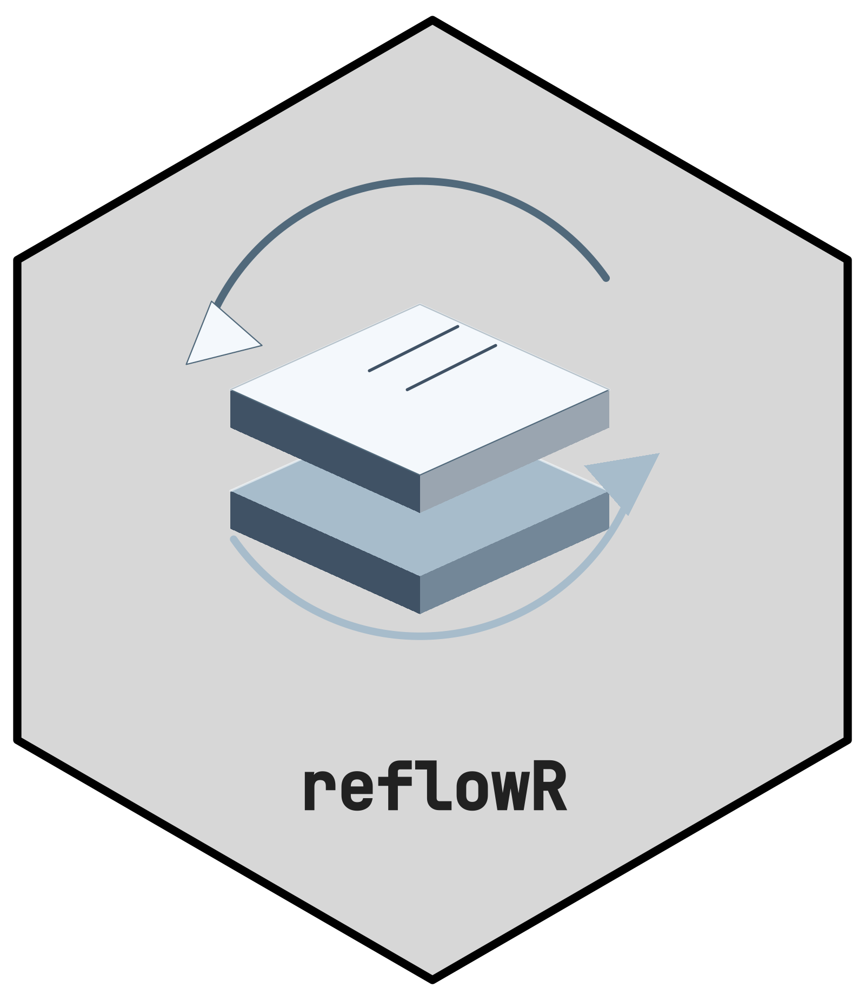

# reflowR <picture class="cttir-readme-logo"><source class="cttir-logo-dark-source" media="(prefers-color-scheme: dark)" srcset="man/figures/logo-with-name-dark.png" /></picture>

[](https://doi.org/10.5281/zenodo.21889956)

> Themed extensions for workflowr research workflows

<!-- badges: start -->
[](https://github.com/CTTIR/reflowR/actions/workflows/R-CMD-check.yaml)
[](https://cttir.github.io/reflowR/)
[](https://CRAN.R-project.org/package=reflowR)
[](https://app.codecov.io/gh/CTTIR/reflowR?branch=main)
[](https://cran.r-project.org/package=reflowR)
[](https://cran.r-project.org/package=reflowR)
[](https://opensource.org/licenses/MIT)
[](https://lifecycle.r-lib.org/articles/stages.html#experimental)
<!-- badges: end -->

## Overview

**reflowR** extends the [workflowr](https://workflowr.github.io/workflowr/) package with themed color schemes, structured analysis pipeline templates, and utility scripts for reproducible research. It wraps `workflowr::wflow_start()` to create a standard workflowr project, then layers on a complete theming and scaffolding system.

### Theming

- **5 color schemes** -- clinical (red), basic research (steelblue), code/statistics (forest green), special (purple), other (grey) -- each with a custom SVG icon, 8-color palette, and full CSS/SCSS theme
- **ggplot2 theme + table styling** that automatically matches the selected scheme
- **Themed navbar** with gradient, icon, and pipeline dropdown menu

### Scaffolding

- **3 depth presets** -- minimal (3 steps), standard (8 steps), extended (12 steps) -- providing a structured Rmd analysis pipeline
- **6 utility scripts** in `code/` -- setup, utils, formulary, data I/O, table helpers, plot helpers
- **Quarto report template** with dual HTML/PDF output

All generated projects remain fully compatible with standard workflowr commands (`wflow_build()`, `wflow_publish()`, etc.).

## Installation

```r
# install.packages("pak")
pak::pak("cttir/reflowR")
# workflowr is installed automatically as a dependency
```

Or using remotes:

```r
remotes::install_github("cttir/reflowR")
```

## Quick Start

```r
library(reflowR)

# Create a clinical research project with the standard 8-step pipeline
reflow_init(
  directory = "~/projects/my_analysis",
  author    = "Your Name",
  email     = "you@example.com",
  scheme    = "clinical",
  depth     = "standard"
)

# Then use standard workflowr commands:
workflowr::wflow_build()
workflowr::wflow_publish("analysis/*.Rmd", message = "Initial build")
```

## Color Schemes

| Scheme | Label | Primary | Use Case |
|--------|-------|---------|----------|
| `clinical` | Clinical Research | `#C8102E` | Clinical trials, patient data |
| `basic` | Basic Research | `#4682B4` | Lab research, general science |
| `code` | Code & Statistics | `#228B22` | Software dev, statistical methods |
| `special` | Special | `#6A0DAD` | Special projects, reviews |
| `other` | Other | `#2C2C2C` | Neutral, multipurpose |

Preview any scheme interactively:

```r
reflow_preview("clinical")
reflow_schemes()
```

## Depth Presets

| Preset | Steps | Best For |
|--------|-------|----------|
| `minimal` | 3 | Quick explorations, side analyses |
| `standard` | 8 | Standard research projects, publications |
| `extended` | 12 | Clinical trials, comprehensive studies |

```r
reflow_presets()
```

## How It Works

reflowR calls `workflowr::wflow_start()` to create the standard workflowr scaffold, then enhances it with themed files. The result is a standard workflowr project -- all workflowr commands work as expected.

## Getting Help

- Browse the [function reference](https://cttir.github.io/reflowR/reference/index.html)
- Read the [Getting Started vignette](https://cttir.github.io/reflowR/articles/getting-started.html)
- File issues at [GitHub Issues](https://github.com/cttir/reflowR/issues)

## Citation

```r
citation("reflowR")
```

## Contributing

Contributions are welcome. Please open an issue first to discuss what you would like to change, then submit a pull request.

## License

MIT

## Recorded imaging workflows

The imaging API runs a sequential graph of exported package functions, with
explicit references to upstream R objects. It is independent of workflowr
scaffolding and does not create Git repositories or publish anything.

```r
plan <- reflow_imaging_plan(
  reflow_imaging_stage("summary", "base", "summary", list(object = 1:4)),
  reflow_imaging_stage("mean", "base", "mean",
                      list(x = reflow_imaging_ref("summary")))
)
run_dir <- tempfile("imaging-run-")
results <- reflow_imaging_run(plan, run_dir)
verified <- reflow_imaging_resume(plan, run_dir)
```

Use `reflow_imaging_input(path)` for tracked files or directories, or set
`read = TRUE` to pass an RDS input as an object. Use the reference's `select`
argument to extract named nested components. Declare optional package backends
with the plan's `packages` argument and stochastic calls with a stage `seed`.

Receipts record configuration, input, installed code, runtime and output hashes.
Resume verifies completed results; changed inputs or corrupt results require a
new run directory. Common numerical thread environment settings are recorded
and changes invalidate resume; this does not measure effective backend thread
counts or capture in-process thread setters. Failed or interrupted calls retry
in new attempt directories.
A lock prevents concurrent execution; stale locks require manual inspection.
Inputs must remain immutable during execution. Calls must be trusted, return
plain serializable R objects, and avoid external side effects: this is not a
sandbox. Resource scheduling, file-producing stages, external engine provenance,
review dashboards and report recipes are not yet implemented by this API.

## Use of LLM tools

Where applicable, LLM tools were used for narrowly defined, non-authorial tasks:
copyediting, prose refinement, Markdown/LaTeX formatting, boilerplate scaffolding
(such as CI configurations and build scripts), and code refactoring. Tools included
[Chat AI](https://kisski.gwdg.de/leistungen/2-02-llm-service/), the KISSKI
(GWDG) service, and self-hosted **Mistral Small (24B, Apache-2.0)** served through
a local **vLLM architecture** on an Ubuntu Linux workstation with Intel
processors and NVIDIA GPUs. The self-hosted model ran locally, with no data sent
to third parties.

All scientific claims, methodological choices, analyses, interpretations and
conclusions remain the authors' own. Where applicable, LLM-generated material
must be reviewed and revised before inclusion, and references must be verified
against their DOI, arXiv ID or ISBN.

Local software setup: vLLM with Python/PyTorch, plus R and RStudio.

## Branding

Editable R artwork and regeneration instructions are in [tools/branding](https://github.com/CTTIR/reflowR/blob/main/tools/branding/README.md).
