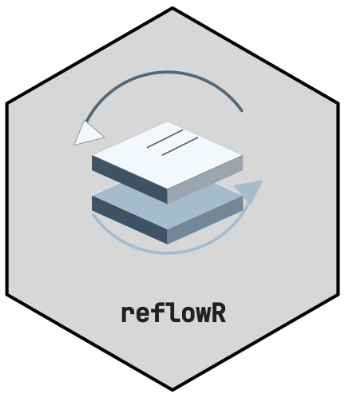
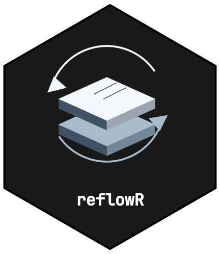

# Getting Started with reflowR



[](https://github.com/CTTIR/reflowR/actions/workflows/R-CMD-check.yaml)
[](https://cttir.github.io/reflowR/)
[](https://app.codecov.io/gh/CTTIR/reflowR?branch=main)
[](https://opensource.org/licenses/MIT)
[](https://lifecycle.r-lib.org/articles/stages.html#experimental)

## What is reflowR?

**reflowR** extends the
[workflowr](https://workflowr.github.io/workflowr/) package with themed
colour schemes, structured analysis pipeline templates, and utility
scripts for reproducible research. It wraps
[`workflowr::wflow_start()`](https://workflowr.github.io/workflowr/reference/wflow_start.html)
and layers on additional structure and theming.

## Installation

``` r

# Install from GitHub (workflowr is installed automatically)
if (!requireNamespace("pak", quietly = TRUE)) install.packages("pak")
pak::pak("CTTIR/reflowR")

# Required by the generated project setup
if (!requireNamespace("here", quietly = TRUE)) install.packages("here")
```

## Quick Start

``` r

library(reflowR)

# Choose a new directory for the clinical 8-step project
dir.create("~/projects", recursive = TRUE, showWarnings = FALSE)
project <- reflow_init(
  directory = "~/projects/my_project",
  author    = "Your Name",
  email     = "you@example.com",
  scheme    = "clinical",
  depth     = "standard",
  change_wd = FALSE,
  open      = FALSE
)
```

## Choosing a Scheme

reflowR schemes are the nine CTTIR v5 topic families:

| Scheme | Label | Accent | Best For |
|----|----|----|----|
| `spectral` | Spectral imaging | Blue (#0072B2) | Imaging, spectroscopy |
| `spatial` | Spatial biology | Bluish green (#009E73) | Tissue and spatial assays |
| `omics` | Molecular data | Reddish purple (#CC79A7) | Sequencing, molecular profiles |
| `clinical` | Clinical science | Vermillion (#D55E00) | Clinical trials, patient data |
| `methods` | Learning & inference | Sky blue (#56B4E9) | Statistical and ML methods |
| `simulation` | Systems & simulation | Orange (#E69F00) | Simulation studies, models |
| `evidence` | Evidence & discovery | Yellow (#F0E442) | Reviews, meta-analyses |
| `platform` | Research infrastructure | Black (#000000) | Software, data, infrastructure |
| `brand` | Science, connected | Blue (#0072B2) | General purpose (default) |

The earlier names `basic`, `code`, `special` and `other` remain accepted
as aliases of `brand`, `methods`, `evidence` and `platform`.

Preview any scheme:

``` r

reflow_preview("clinical")
```

## Choosing a Depth

| Preset     | Steps | Best For                                 |
|------------|-------|------------------------------------------|
| `minimal`  | 3     | Quick explorations, side analyses        |
| `standard` | 8     | Standard research projects, publications |
| `extended` | 12    | Clinical trials, comprehensive studies   |

## Project Structure

After
[`reflow_init()`](https://cttir.github.io/reflowR/reference/reflow_init.md),
your project contains:

    my_project/
    +-- analysis/        # Rmd pipeline files (rendered to docs/)
    |   +-- _site.yml    # Themed navbar + output config
    |   +-- index.Rmd    # Home page with pipeline table
    |   +-- about.Rmd    # Author card + pipeline docs
    |   +-- 01_read_data.Rmd  # ... pipeline steps
    |   +-- ...
    +-- assets/          # Theme CSS, SCSS, and family icon
    +-- code/            # R scripts
    |   +-- 00_setup.R   # Packages, paths, colors, ggplot theme
    |   +-- utils.R      # Helper functions
    |   +-- formulary.R  # Reusable analysis recipes
    |   +-- data_io.R    # Data import/export
    |   +-- table_helpers.R  # Table builders
    |   +-- plot_helpers.R   # Plot constructors
    +-- data/raw/        # Raw data (never modify)
    +-- data/processed/  # Cleaned data
    +-- docs/            # Rendered HTML site
    +-- output/          # Figures, tables, models
    +-- report/          # Quarto report template

## Working with Your Project

The returned `project` path makes the following commands work from the
calling directory. Generated `code/00_setup.R` reports additional
packages required by individual analysis helpers. Install them before
using those helpers; they are not installed automatically. The optional
table helpers use `gtsummary >= 2.0.0` and require R \>= 4.2, while core
reflowR supports R \>= 4.1. The initial scaffold supplies templates, not
completed analyses.

After reviewing your analysis, use standard workflowr commands:

``` r

# Render all Rmd files
workflowr::wflow_build(project = project)

# Commit and publish
workflowr::wflow_publish(file.path(project, "analysis", "*.Rmd"),
                        message = "Initial build",
                        project = project)

# Check status
workflowr::wflow_status(project = project)

# View the site
workflowr::wflow_view(project = project)

# Set up GitHub Pages
workflowr::wflow_use_github("username", "repo", project = project)
```

## Paired comparisons in the generated formulary

After sourcing `code/formulary.R`, `wf_compare_groups()` can compare two
paired groups using an explicit participant or specimen identifier:

``` r

comparison <- wf_compare_groups(
  measurements, outcome = "value", group = "visit",
  paired = TRUE, pair_id = "participant_id"
)
```

Every ID must occur exactly once in each of the two groups, with a
finite numeric outcome. Missing, duplicate or unmatched IDs are refused;
row order never defines pairing. Factor levels define the first and
second groups; otherwise group labels are sorted. Reported differences
follow first minus second. IDs such as `"001"` and `"1"` remain
distinct.

The existing automatic selector uses a Shapiro–Wilk check of the
within-pair differences for 3–5,000 pairs. Otherwise it retains its
t-test convention. The paired t test reports Cohen’s *d* standardized by
the standard deviation of the differences; the Wilcoxon signed-rank test
reports matched-pairs rank-biserial correlation. Both use the same
ID-aligned observations. Constant or nonfinite differences are refused.
This convenience selector does not validate study design, test
assumptions or scientific inference; choose and justify the analysis
before using its results. Unpaired calls retain their existing
behaviour. Existing generated projects must update `code/formulary.R`
deliberately to receive this repair.

## Customization

- **CSS**: Edit `analysis/theme.css` to customize styling
- **New Rmd files**: Add to `analysis/` and update `_site.yml` navbar
- **Navbar**: Edit `analysis/_site.yml`
- **ggplot theme**: Modify `theme_wf()` in `code/00_setup.R`
