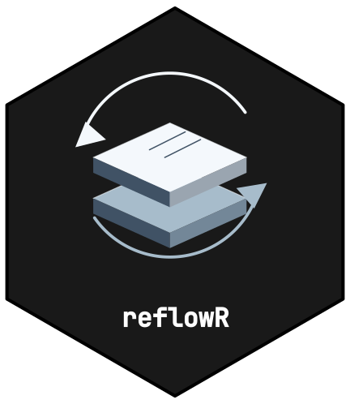

# Colour Schemes Reference



[](https://github.com/CTTIR/reflowR/actions/workflows/R-CMD-check.yaml)
[](https://cttir.github.io/reflowR/)
[](https://app.codecov.io/gh/CTTIR/reflowR?branch=main)
[](https://opensource.org/licenses/MIT)
[](https://lifecycle.r-lib.org/articles/stages.html#experimental)

## CTTIR v5 families

reflowR schemes are the nine topic families of the CTTIR v5 design
language, the same set used by hexmakR artwork and the themakR
documentation template. Every colour and font comes from
`design_tokens.csv`, shipped with the package in `inst/cttir/`. Colour
supports identity; text, headings and links always use neutral tokens.

|  | Key | Label | Accent | Face, light | Face, dark |
|----|----|----|----|----|----|
| ![](data:image/svg+xml;base64,PHN2ZyB4bWxucz0iaHR0cDovL3d3dy53My5vcmcvMjAwMC9zdmciIHdpZHRoPSI1NiIgaGVpZ2h0PSI2NCIgdmlld0JveD0iMCAwIDU2IDY0IiByb2xlPSJpbWciIGFyaWEtbGFiZWw9IlNwZWN0cmFsIGltYWdpbmciPgo8cG9seWdvbiBwb2ludHM9IjI4LDEuNSAxLjU5LDE2Ljc1IDEuNTksNDcuMjUgMjgsNjIuNSA1NC40MSw0Ny4yNSA1NC40MSwxNi43NSIgZmlsbD0iI0Q3RTZFRiIgc3Ryb2tlPSIjMDA3MkIyIiBzdHJva2Utd2lkdGg9IjMiIHN0cm9rZS1saW5lam9pbj0icm91bmQiLz4KPGcgY29sb3I9IiMwQTRENzYiIGZpbGw9Im5vbmUiIHN0cm9rZT0iY3VycmVudENvbG9yIiBzdHJva2Utd2lkdGg9IjMiIHN0cm9rZS1saW5lY2FwPSJyb3VuZCIgc3Ryb2tlLWxpbmVqb2luPSJyb3VuZCI+CiAgPHBvbHlsaW5lIHBvaW50cz0iMTUsNDIuNSA0MSw0Mi41Ii8+CiAgPHBvbHlsaW5lIHBvaW50cz0iMTYsNDAgMTYuNjcsMzkuOTkgMTcuMzMsMzkuOTggMTgsMzkuOTMgMTguNjcsMzkuNzggMTkuMzMsMzkuNCAyMCwzOC41OSAyMC42NywzNy4xIDIxLjMzLDM0Ljc2IDIyLDMxLjcgMjIuNjcsMjguNDcgMjMuMzMsMjUuOTUgMjQsMjUgMjQuNjcsMjUuOTUgMjUuMzMsMjguNDcgMjYsMzEuNyAyNi42NywzNC43NSAyNy4zMywzNy4wNyAyOCwzOC40OCAyOC42NywzOS4wNiAyOS4zMywzOC45IDMwLDM4LjA0IDMwLjY3LDM2LjQ4IDMxLjMzLDM0LjQ0IDMyLDMyLjQzIDMyLjY3LDMxLjE3IDMzLjMzLDMxLjE3IDM0LDMyLjQzIDM0LjY3LDM0LjQ0IDM1LjMzLDM2LjUgMzYsMzguMTEgMzYuNjcsMzkuMTMgMzcuMzMsMzkuNjUgMzgsMzkuODggMzguNjcsMzkuOTcgMzkuMzMsMzkuOTkgNDAsNDAiLz4KPC9nPgo8L3N2Zz4=) | `spectral` | Spectral imaging |  `#0072B2` |  `#D7E6EF` |  `#193443` |
| ![](data:image/svg+xml;base64,PHN2ZyB4bWxucz0iaHR0cDovL3d3dy53My5vcmcvMjAwMC9zdmciIHdpZHRoPSI1NiIgaGVpZ2h0PSI2NCIgdmlld0JveD0iMCAwIDU2IDY0IiByb2xlPSJpbWciIGFyaWEtbGFiZWw9IlNwYXRpYWwgYmlvbG9neSI+Cjxwb2x5Z29uIHBvaW50cz0iMjgsMS41IDEuNTksMTYuNzUgMS41OSw0Ny4yNSAyOCw2Mi41IDU0LjQxLDQ3LjI1IDU0LjQxLDE2Ljc1IiBmaWxsPSIjRDdFREU3IiBzdHJva2U9IiMwMDlFNzMiIHN0cm9rZS13aWR0aD0iMyIgc3Ryb2tlLWxpbmVqb2luPSJyb3VuZCIvPgo8ZyBjb2xvcj0iIzBBNjM1NiIgZmlsbD0ibm9uZSIgc3Ryb2tlPSJjdXJyZW50Q29sb3IiIHN0cm9rZS13aWR0aD0iMyIgc3Ryb2tlLWxpbmVjYXA9InJvdW5kIiBzdHJva2UtbGluZWpvaW49InJvdW5kIj4KICA8Y2lyY2xlIGN4PSIyMCIgY3k9IjI0IiByPSIyLjgiIGZpbGw9ImN1cnJlbnRDb2xvciIgc3Ryb2tlPSJub25lIi8+CiAgPGNpcmNsZSBjeD0iMjgiIGN5PSIyNCIgcj0iMi44IiBmaWxsPSJjdXJyZW50Q29sb3IiIHN0cm9rZT0ibm9uZSIvPgogIDxjaXJjbGUgY3g9IjM2IiBjeT0iMjQiIHI9IjIuOCIgZmlsbD0iY3VycmVudENvbG9yIiBzdHJva2U9Im5vbmUiLz4KICA8Y2lyY2xlIGN4PSIyMCIgY3k9IjMyIiByPSIyLjgiIGZpbGw9ImN1cnJlbnRDb2xvciIgc3Ryb2tlPSJub25lIi8+CiAgPGNpcmNsZSBjeD0iMjgiIGN5PSIzMiIgcj0iMi44IiBmaWxsPSJjdXJyZW50Q29sb3IiIHN0cm9rZT0ibm9uZSIvPgogIDxjaXJjbGUgY3g9IjM2IiBjeT0iMzIiIHI9IjIuOCIgZmlsbD0iY3VycmVudENvbG9yIiBzdHJva2U9Im5vbmUiLz4KICA8Y2lyY2xlIGN4PSIyMCIgY3k9IjQwIiByPSIyLjgiIGZpbGw9ImN1cnJlbnRDb2xvciIgc3Ryb2tlPSJub25lIi8+CiAgPGNpcmNsZSBjeD0iMjgiIGN5PSI0MCIgcj0iMi44IiBmaWxsPSJjdXJyZW50Q29sb3IiIHN0cm9rZT0ibm9uZSIvPgogIDxjaXJjbGUgY3g9IjM2IiBjeT0iNDAiIHI9IjIuOCIgZmlsbD0iY3VycmVudENvbG9yIiBzdHJva2U9Im5vbmUiLz4KPC9nPgo8L3N2Zz4=) | `spatial` | Spatial biology |  `#009E73` |  `#D7EDE7` |  `#193F34` |
| ![](data:image/svg+xml;base64,PHN2ZyB4bWxucz0iaHR0cDovL3d3dy53My5vcmcvMjAwMC9zdmciIHdpZHRoPSI1NiIgaGVpZ2h0PSI2NCIgdmlld0JveD0iMCAwIDU2IDY0IiByb2xlPSJpbWciIGFyaWEtbGFiZWw9Ik1vbGVjdWxhciBkYXRhIj4KPHBvbHlnb24gcG9pbnRzPSIyOCwxLjUgMS41OSwxNi43NSAxLjU5LDQ3LjI1IDI4LDYyLjUgNTQuNDEsNDcuMjUgNTQuNDEsMTYuNzUiIGZpbGw9IiNGM0U3RUUiIHN0cm9rZT0iI0NDNzlBNyIgc3Ryb2tlLXdpZHRoPSIzIiBzdHJva2UtbGluZWpvaW49InJvdW5kIi8+CjxnIGNvbG9yPSIjNzA1MDcwIiBmaWxsPSJub25lIiBzdHJva2U9ImN1cnJlbnRDb2xvciIgc3Ryb2tlLXdpZHRoPSIzIiBzdHJva2UtbGluZWNhcD0icm91bmQiIHN0cm9rZS1saW5lam9pbj0icm91bmQiPgogIDxwb2x5bGluZSBwb2ludHM9IjI4LDE4IDI5LjQ2LDE4Ljg4IDMwLjg3LDE5Ljc1IDMyLjE3LDIwLjYyIDMzLjMsMjEuNSAzNC4yNCwyMi4zOCAzNC45MywyMy4yNSAzNS4zNiwyNC4xMiAzNS41LDI1IDM1LjM2LDI1Ljg4IDM0LjkzLDI2Ljc1IDM0LjI0LDI3LjYyIDMzLjMsMjguNSAzMi4xNywyOS4zOCAzMC44NywzMC4yNSAyOS40NiwzMS4xMiAyOCwzMiAyNi41NCwzMi44OCAyNS4xMywzMy43NSAyMy44MywzNC42MiAyMi43LDM1LjUgMjEuNzYsMzYuMzggMjEuMDcsMzcuMjUgMjAuNjQsMzguMTIgMjAuNSwzOSAyMC42NCwzOS44OCAyMS4wNyw0MC43NSAyMS43Niw0MS42MiAyMi43LDQyLjUgMjMuODMsNDMuMzggMjUuMTMsNDQuMjUgMjYuNTQsNDUuMTIgMjgsNDYiLz4KICA8cG9seWxpbmUgcG9pbnRzPSIyOCwxOCAyNi41NCwxOC44OCAyNS4xMywxOS43NSAyMy44MywyMC42MiAyMi43LDIxLjUgMjEuNzYsMjIuMzggMjEuMDcsMjMuMjUgMjAuNjQsMjQuMTIgMjAuNSwyNSAyMC42NCwyNS44OCAyMS4wNywyNi43NSAyMS43NiwyNy42MiAyMi43LDI4LjUgMjMuODMsMjkuMzggMjUuMTMsMzAuMjUgMjYuNTQsMzEuMTIgMjgsMzIgMjkuNDYsMzIuODggMzAuODcsMzMuNzUgMzIuMTcsMzQuNjIgMzMuMywzNS41IDM0LjI0LDM2LjM4IDM0LjkzLDM3LjI1IDM1LjM2LDM4LjEyIDM1LjUsMzkgMzUuMzYsMzkuODggMzQuOTMsNDAuNzUgMzQuMjQsNDEuNjIgMzMuMyw0Mi41IDMyLjE3LDQzLjM4IDMwLjg3LDQ0LjI1IDI5LjQ2LDQ1LjEyIDI4LDQ2Ii8+CiAgPHBvbHlsaW5lIHBvaW50cz0iMjAuNSwyNSAzNS41LDI1Ii8+CiAgPHBvbHlsaW5lIHBvaW50cz0iMjAuNSwzOSAzNS41LDM5Ii8+CjwvZz4KPC9zdmc+) | `omics` | Molecular data |  `#CC79A7` |  `#F3E7EE` |  `#4A3641` |
|  | `clinical` | Clinical science |  `#D55E00` |  `#F4E4D7` |  `#4C2F19` |
|  | `methods` | Learning & inference |  `#56B4E9` |  `#E3F0F7` |  `#2D4451` |
| ![](data:image/svg+xml;base64,PHN2ZyB4bWxucz0iaHR0cDovL3d3dy53My5vcmcvMjAwMC9zdmciIHdpZHRoPSI1NiIgaGVpZ2h0PSI2NCIgdmlld0JveD0iMCAwIDU2IDY0IiByb2xlPSJpbWciIGFyaWEtbGFiZWw9IlN5c3RlbXMgJmFtcDsgc2ltdWxhdGlvbiI+Cjxwb2x5Z29uIHBvaW50cz0iMjgsMS41IDEuNTksMTYuNzUgMS41OSw0Ny4yNSAyOCw2Mi41IDU0LjQxLDQ3LjI1IDU0LjQxLDE2Ljc1IiBmaWxsPSIjRjdFREQ3IiBzdHJva2U9IiNFNjlGMDAiIHN0cm9rZS13aWR0aD0iMyIgc3Ryb2tlLWxpbmVqb2luPSJyb3VuZCIvPgo8ZyBjb2xvcj0iIzdENjMxRCIgZmlsbD0ibm9uZSIgc3Ryb2tlPSJjdXJyZW50Q29sb3IiIHN0cm9rZS13aWR0aD0iMyIgc3Ryb2tlLWxpbmVjYXA9InJvdW5kIiBzdHJva2UtbGluZWpvaW49InJvdW5kIj4KICA8cG9seWxpbmUgcG9pbnRzPSIzMS40MiwyMi42IDI5Ljc0LDIyLjE1IDI4LDIyIDI2LjI2LDIyLjE1IDI0LjU4LDIyLjYgMjMsMjMuMzQgMjEuNTcsMjQuMzQgMjAuMzQsMjUuNTcgMTkuMzQsMjcgMTguNiwyOC41OCAxOC4xNSwzMC4yNiAxOCwzMiAxOC4xNSwzMy43NCAxOC42LDM1LjQyIDE5LjM0LDM3IDIwLjM0LDM4LjQzIDIxLjU3LDM5LjY2IDIzLDQwLjY2IDI0LjU4LDQxLjQgMjYuMjYsNDEuODUgMjgsNDIgMjkuNzQsNDEuODUgMzEuNDIsNDEuNCAzMyw0MC42NiAzNC40MywzOS42NiAzNS42NiwzOC40MyAzNi42NiwzNyAzNy40LDM1LjQyIDM3Ljg1LDMzLjc0IDM4LDMyIDM3Ljg1LDMwLjI2IDM3LjQsMjguNTgiLz4KICA8cG9seWdvbiBwb2ludHM9IjMzLjIsMjUuMzggNDEuNiwyNy4xOCAzOSwzMy43OCIgZmlsbD0iY3VycmVudENvbG9yIiBzdHJva2U9Im5vbmUiLz4KPC9nPgo8L3N2Zz4=) | `simulation` | Systems & simulation |  `#E69F00` |  `#F7EDD7` |  `#503F19` |
|  | `evidence` | Evidence & discovery |  `#F0E442` |  `#F8F6E0` |  `#524F28` |
|  | `platform` | Research infrastructure |  `#000000` |  `#D7D7D7` |  `#191919` |
| ![](data:image/svg+xml;base64,PHN2ZyB4bWxucz0iaHR0cDovL3d3dy53My5vcmcvMjAwMC9zdmciIHdpZHRoPSI1NiIgaGVpZ2h0PSI2NCIgdmlld0JveD0iMCAwIDU2IDY0IiByb2xlPSJpbWciIGFyaWEtbGFiZWw9IlNjaWVuY2UsIGNvbm5lY3RlZCI+Cjxwb2x5Z29uIHBvaW50cz0iMjgsMS41IDEuNTksMTYuNzUgMS41OSw0Ny4yNSAyOCw2Mi41IDU0LjQxLDQ3LjI1IDU0LjQxLDE2Ljc1IiBmaWxsPSIjRDdFNkVGIiBzdHJva2U9IiMwMDcyQjIiIHN0cm9rZS13aWR0aD0iMyIgc3Ryb2tlLWxpbmVqb2luPSJyb3VuZCIvPgo8ZyBjb2xvcj0iIzBBNEQ3NiIgZmlsbD0ibm9uZSIgc3Ryb2tlPSJjdXJyZW50Q29sb3IiIHN0cm9rZS13aWR0aD0iMyIgc3Ryb2tlLWxpbmVjYXA9InJvdW5kIiBzdHJva2UtbGluZWpvaW49InJvdW5kIj4KICA8cG9seWxpbmUgcG9pbnRzPSIyOCwzMiAyOCwyMSIvPgogIDxwb2x5bGluZSBwb2ludHM9IjI4LDMyIDE4LjQ3LDM3LjUiLz4KICA8cG9seWxpbmUgcG9pbnRzPSIyOCwzMiAzNy41MywzNy41Ii8+CiAgPGNpcmNsZSBjeD0iMjgiIGN5PSIzMiIgcj0iMy42IiBmaWxsPSJjdXJyZW50Q29sb3IiIHN0cm9rZT0ibm9uZSIvPgogIDxjaXJjbGUgY3g9IjI4IiBjeT0iMjEiIHI9IjMiIGZpbGw9ImN1cnJlbnRDb2xvciIgc3Ryb2tlPSJub25lIi8+CiAgPGNpcmNsZSBjeD0iMTguNDciIGN5PSIzNy41IiByPSIzIiBmaWxsPSJjdXJyZW50Q29sb3IiIHN0cm9rZT0ibm9uZSIvPgogIDxjaXJjbGUgY3g9IjM3LjUzIiBjeT0iMzcuNSIgcj0iMyIgZmlsbD0iY3VycmVudENvbG9yIiBzdHJva2U9Im5vbmUiLz4KPC9nPgo8L3N2Zz4=) | `brand` | Science, connected |  `#0072B2` |  `#D7E6EF` |  `#193443` |

`brand` is the CTTIR default and the default of
[`reflow_init()`](https://cttir.github.io/reflowR/dev/reference/reflow_init.md).
Pick the family that best describes the project:

| Context                                 | Family       |
|-----------------------------------------|--------------|
| Clinical trial, patient data            | `clinical`   |
| Imaging and spectroscopy                | `spectral`   |
| Tissue and spatial assays               | `spatial`    |
| Sequencing and molecular profiles       | `omics`      |
| Statistical or machine-learning methods | `methods`    |
| Simulation and systems models           | `simulation` |
| Systematic reviews, meta-analyses       | `evidence`   |
| Software, data and infrastructure       | `platform`   |
| General purpose                         | `brand`      |

## Earlier scheme names

The five schemes of reflowR 0.1.0 remain accepted. `clinical` keeps its
name and now uses the v5 vermillion; the others are aliases that print a
one-time message:

| Earlier name | v5 family  |
|--------------|------------|
| `basic`      | `brand`    |
| `code`       | `methods`  |
| `special`    | `evidence` |
| `other`      | `platform` |

## Generated site styling

[`reflow_init()`](https://cttir.github.io/reflowR/dev/reference/reflow_init.md)
writes `analysis/theme.css` (workflowr) and `assets/_theme.scss` (Quarto
report). Both follow the themakR surface:

| Role                  | Light     | Dark      |
|-----------------------|-----------|-----------|
| Page and flat navbar  | `#FAFAFA` | `#212121` |
| Text                  | `#212121` | `#DADADA` |
| Headings, navbar text | `#212121` | `#FFFFFF` |
| Links                 | `#1565C0` | `#42A5F5` |
| Code surface          | `#E9E9E9` | `#2B2B2B` |
| Borders, h2 rule      | `#D8D8D8` | `#4F4F4F` |

Dark mode follows the reader’s system setting and can be forced with
`data-bs-theme="dark"` or `body.colorscheme-dark`. The family accent
marks only non-text identity elements: the 3px navbar rule, the h1
underline, active navigation and table-of-contents markers, callout
borders and table header rules. Pages use the `--cttir-*` custom
properties of themakR plus `--cttir-topic`.

Body text uses `"Inter", system-ui, sans-serif`, code
`"JetBrains Mono", ui-monospace, monospace` and the navbar name
JetBrains Mono at weight 600. Nothing is downloaded: sites without these
fonts fall back to system fonts.

## In R code

`code/00_setup.R` provides the same values for figures and tables:

``` r

wf_colors$primary   # family accent
wf_colors$face      # tinted surface, e.g. facet strips
wf_palette          # Okabe-Ito topic colours, accent first
wf_fonts$body       # "Inter"

ggplot(df, aes(x, y, colour = group)) + geom_point() +
  scale_color_wf() + theme_wf()
```

Inspect or preview a family directly:

``` r

reflow_schemes()
s <- reflow_scheme("spatial")
s$accent
s$palette
reflow_preview("spatial")
```
