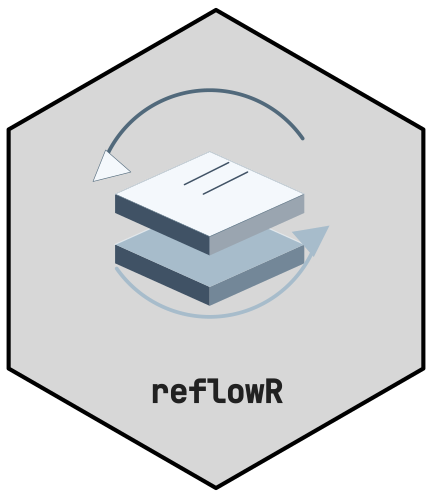

<!-- cttir-vignette-logo: start -->
<style>
.cttir-vignette-logo { float: right; width: 120px; max-width: 30%; margin: 0 0 1rem 1.5rem; }
.cttir-vignette-logo img { width: 100%; height: auto; border: 0; background: transparent; box-shadow: none; }
.cttir-vignette-logo .cttir-vignette-logo-light { display: block; }
.cttir-vignette-logo .cttir-vignette-logo-dark { display: none; }
@media (prefers-color-scheme: dark) {
  .cttir-vignette-logo .cttir-vignette-logo-light { display: none; }
  .cttir-vignette-logo .cttir-vignette-logo-dark { display: block; }
}
[data-bs-theme="light"] .cttir-vignette-logo .cttir-vignette-logo-light { display: block; }
[data-bs-theme="light"] .cttir-vignette-logo .cttir-vignette-logo-dark { display: none; }
[data-bs-theme="dark"] .cttir-vignette-logo .cttir-vignette-logo-light { display: none; }
[data-bs-theme="dark"] .cttir-vignette-logo .cttir-vignette-logo-dark { display: block; }
</style>
<div class="cttir-vignette-logo">
  
  
</div>
<!-- cttir-vignette-logo: end -->

<!-- badges: start -->
[](https://github.com/CTTIR/reflowR/actions/workflows/R-CMD-check.yaml)
[](https://cttir.github.io/reflowR/)
[](https://CRAN.R-project.org/package=reflowR)
[](https://app.codecov.io/gh/CTTIR/reflowR?branch=main)
[](https://cran.r-project.org/package=reflowR)
[](https://cran.r-project.org/package=reflowR)
[](https://opensource.org/licenses/MIT)
[](https://lifecycle.r-lib.org/articles/stages.html#experimental)
<!-- badges: end -->

```{r, include = FALSE}
knitr::opts_chunk$set(
  collapse = TRUE,
  comment = "#>",
  eval = FALSE
)
```

## What is reflowR?

**reflowR** extends the [workflowr](https://workflowr.github.io/workflowr/)
package with themed color schemes, structured analysis pipeline templates,
and utility scripts for reproducible research. It wraps
`workflowr::wflow_start()` and layers on additional structure and theming.

## Installation

```r
# Install from GitHub (workflowr is installed automatically)
remotes::install_github("cttir/reflowR")
```

## Quick Start

```r
library(reflowR)

# Create a clinical research project with the standard 8-step pipeline
reflow_init(
  directory = "~/projects/sepsis_trial",
  author    = "Raban Heller",
  email     = "raban.heller@outlook.com",
  scheme    = "clinical",
  depth     = "standard"
)
```

## Choosing a Scheme

reflowR schemes are the nine CTTIR v5 topic families:

| Scheme | Label | Accent | Best For |
|--------|-------|--------|----------|
| `spectral` | Spectral imaging | Blue (#0072B2) | Imaging, spectroscopy |
| `spatial` | Spatial biology | Bluish green (#009E73) | Tissue and spatial assays |
| `omics` | Molecular data | Reddish purple (#CC79A7) | Sequencing, molecular profiles |
| `clinical` | Clinical science | Vermillion (#D55E00) | Clinical trials, patient data |
| `methods` | Learning & inference | Sky blue (#56B4E9) | Statistical and ML methods |
| `simulation` | Systems & simulation | Orange (#E69F00) | Simulation studies, models |
| `evidence` | Evidence & discovery | Yellow (#F0E442) | Reviews, meta-analyses |
| `platform` | Research infrastructure | Black (#000000) | Software, data, infrastructure |
| `brand` | Science, connected | Blue (#0072B2) | General purpose (default) |

The earlier names `basic`, `code`, `special` and `other` remain accepted as
aliases of `brand`, `methods`, `evidence` and `platform`.

Preview any scheme:

```r
reflow_preview("clinical")
```

## Choosing a Depth

| Preset | Steps | Best For |
|--------|-------|----------|
| `minimal` | 3 | Quick explorations, side analyses |
| `standard` | 8 | Standard research projects, publications |
| `extended` | 12 | Clinical trials, comprehensive studies |

## Project Structure

After `reflow_init()`, your project contains:

```
my_project/
+-- analysis/        # Rmd pipeline files (rendered to docs/)
|   +-- _site.yml    # Themed navbar + output config
|   +-- index.Rmd    # Home page with pipeline table
|   +-- about.Rmd    # Author card + pipeline docs
|   +-- 01_read_data.Rmd  # ... pipeline steps
|   +-- ...
+-- assets/          # Theme CSS, SCSS, and family icon
+-- code/            # R scripts
|   +-- 00_setup.R   # Packages, paths, colors, ggplot theme
|   +-- utils.R      # Helper functions
|   +-- formulary.R  # Reusable analysis recipes
|   +-- data_io.R    # Data import/export
|   +-- table_helpers.R  # Table builders
|   +-- plot_helpers.R   # Plot constructors
+-- data/raw/        # Raw data (never modify)
+-- data/processed/  # Cleaned data
+-- docs/            # Rendered HTML site
+-- output/          # Figures, tables, models
+-- report/          # Quarto report template
```

## Working with Your Project

After creation, use standard workflowr commands:

```r
# Render all Rmd files
workflowr::wflow_build()

# Commit and publish
workflowr::wflow_publish("analysis/*.Rmd", message = "Initial build")

# Check status
workflowr::wflow_status()

# View the site
workflowr::wflow_view()

# Set up GitHub Pages
workflowr::wflow_use_github("username", "repo")
```

## Customization

- **CSS**: Edit `assets/theme.css` to customize styling
- **New Rmd files**: Add to `analysis/` and update `_site.yml` navbar
- **Navbar**: Edit `analysis/_site.yml`
- **ggplot theme**: Modify `theme_wf()` in `code/00_setup.R`
